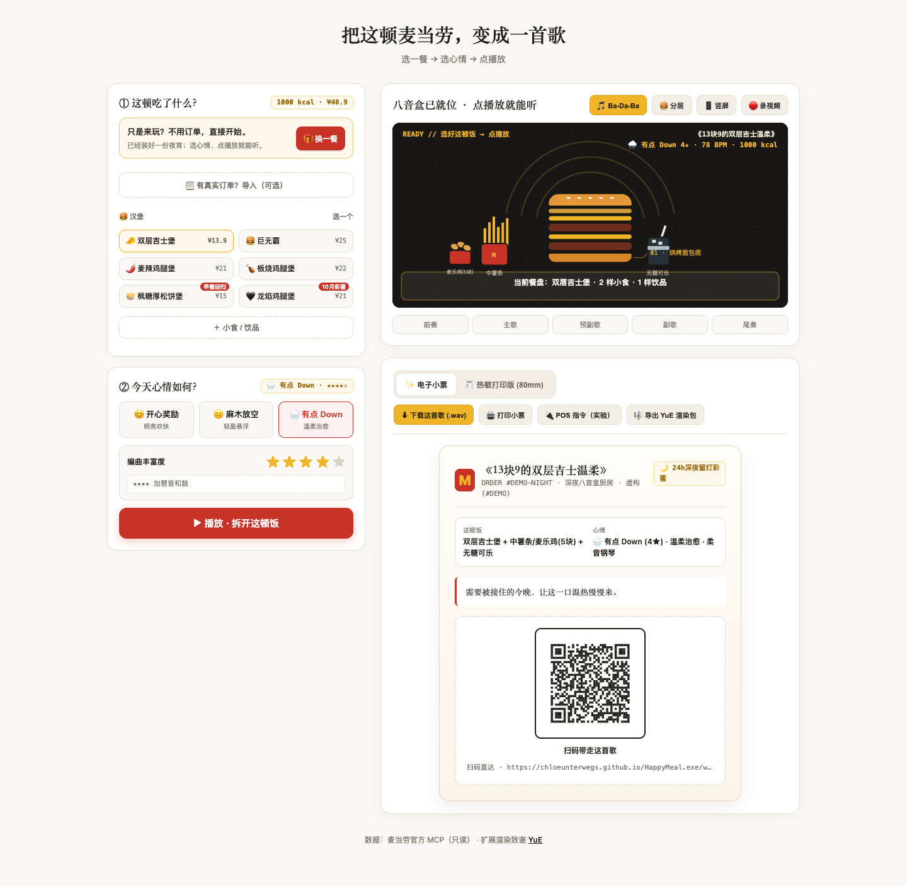

# HappyMeal.exe

**大人版开心乐园餐：把一顿麦当劳，变成一首歌。**

打开就能玩：无需登录、Token 或订单，直接选餐、选心情、点播放。汉堡会随节拍逐层组装，生成一段约 30 秒的治愈系音乐；电子小票与热敏打印版小票可以通过二维码打开对应页面，并下载这首歌的 `.wav` 音频。真实麦当劳订单只是可选增强，不是使用门槛。

> 非麦当劳官方产品，仅为程序员创意开发大赛参赛作品。页面音频由 Web Audio 即时合成；YuE 仅作为扩展渲染包的致谢与桥接方向，本项目未使用 YuE 生成当前音频。

## 在线体验

GitHub Pages 地址：

**https://chloeunterwegs.github.io/HappyMeal.exe/web/index.html**

如页面尚未开放，表示仓库已发布但 Pages 仍在配置或部署中，可先按下面的本地方式运行。



[查看当前手机竖屏界面](./docs/assets/preview-mobile.png)

## 主要功能

- **无需订单直接玩**：默认套餐立即可听，「换一餐」可循环体验五组虚构预设，也可完全自由选餐。
- **可选真实订单**：通过只读 MCP `order-list` 拉取；高级入口支持粘贴订单 JSON，均不影响普通玩家。
- **三心情 × 五级编曲**：开心奖励、麻木放空、有点 Down；星级控制声部丰富度。
- **卡点动画**：汉堡层掉落与主歌、副歌节拍对应，支持分层蓝图和 9:16 竖屏。
- **同一份乐谱**：实时播放与 WAV 离线渲染共享 `compileSongScore()`，避免两种结果不一致。
- **双小票**：电子典藏版、80mm 浏览器打印版；公开二维码仅包含短 ID 和编曲参数。
- **扩展导出**：YuE 符号乐谱渲染包、实验性 ESC/POS 字节流、浏览器内录 `.webm`。

## 目标用户

- 想把日常消费记录转成轻量音乐纪念品的人。
- 需要快速生成短片配乐、动态小票和社交素材的内容创作者。
- 希望查看 MCP 真实订单如何驱动前端交互与生成式体验的开发者。

## 安装与本地运行

项目是纯静态前端，无 npm 依赖、无后端、无需构建。

```bash
git clone https://github.com/Chloeunterwegs/HappyMeal.exe.git
cd HappyMeal.exe
python3 -m http.server 8742 --bind 127.0.0.1
```

浏览器打开：

```text
http://127.0.0.1:8742/web/index.html
```

也可以使用任意静态 HTTP 服务器。不要直接双击 HTML 文件，以免浏览器安全策略影响部分功能。

## 使用示例

### A. 无 Token：打开就玩

1. 打开页面，使用已经装好的夜宵套餐，或点击「换一餐」体验其他虚构预设。
2. 也可以直接手动选择汉堡、小食和饮品，不需要展开订单导入。
3. 选择心情与编曲星级，点击「播放 · 拆开这顿饭」。
4. 点击「下载这首歌 (.wav)」，或用手机扫描小票二维码。

所有预设均使用 `DEMO` 单号和明确标注的虚构厨房，不会冒充真实 MCP 返回。

### B. 真实订单：本机只读导出后导入（推荐）

这是可复验的主流程，公开 Pages 不需要后端，也不会在仓库中保存 Token 或真实订单。

1. 在 [麦当劳 MCP 开放平台](https://open.mcd.cn/mcp) 登录，进入「控制台」申请 Token。
2. 在仓库根目录打开终端，按提示隐藏输入 Token：

```bash
printf 'MCD MCP Token: '
read -s MCD_MCP_TOKEN
printf '\n'
export MCD_MCP_TOKEN
PYTHONPATH= python3 scripts/mcp_engine.py \
  --live-order-list \
  --out "${TMPDIR:-/tmp}/happymeal-orders.json"
unset MCD_MCP_TOKEN
```

3. 打开导出的 JSON，全选复制；在页面点击「有真实订单？导入（可选）」→「高级：粘贴订单 JSON」→「解析并导入」。
4. 选择订单，继续选心情、播放和下载。

脚本只调用 `order-list`。真实订单文件默认位于系统临时目录，**不要提交到 Git，也不要公开分享原始文件**。

### C. 浏览器直连（增强路径）

展开「有真实订单？导入（可选）」，输入 Token 并点击「拉取订单」。页面会执行 MCP 初始化后调用只读 `order-list`。

该路径可能受浏览器 CORS、网络或服务端策略影响；失败时请使用流程 B。Token 仅用于当前页面请求，不会写入代码或 localStorage。

### D. 重新生成静态演示数据

```bash
PYTHONPATH= python3 scripts/mcp_engine.py --preset all --out data/presets_bundle.json
```

此命令处理本地合成预设，**不代表进行了在线 MCP 调用**。

## 隐私与安全

- Token 只从环境变量或页面密码框读取，不得硬编码或提交。
- MCP 运行链只读取历史订单；不调用下单、取消订单、抽奖、领券、商城下单、团餐或地址创建工具。
- 公开分享链接使用由订单号生成的短 ID，不包含原始订单号、门店码或门店名称。
- 原始订单、真实导出文件和内部交接资料不进入公开仓库。
- 小票和本地导出的 YuE 文件可能仍包含当前订单信息，分享前请自行检查。

详细接入说明见 [MCP_INTEGRATION.md](./MCP_INTEGRATION.md)。

## 功能边界

| 功能 | 当前定位 |
|---|---|
| 页面音乐 | Web Audio 即时合成；约 30 秒，可循环播放 |
| WAV | 当前乐谱的一次完整离线渲染，不是 YuE 生成音频 |
| YuE | 导出风格、结构、和弦与动机包；需使用者自行配置 GPU 与 YuE |
| 浏览器打印 | 已提供 80mm 排版和 `window.print()` |
| ESC/POS | 实验性字节流；不同机型仍需验证编码、传输与实体输出 |
| 内录视频 | 依赖浏览器 MediaRecorder；不支持的浏览器请改用系统录屏 |

## 项目结构

```text
web/index.html                 单文件前端应用
scripts/mcp_engine.py          MCP 只读客户端、订单导出与本地预设生成
scripts/thermal_printer.py     实验性 ESC/POS 工具
data/presets_bundle.json       合成演示数据
CONTEST_DECLARATION.md         官方参赛声明，未修改
MCP_INTEGRATION.md             MCP 实际调用与业务链路
mcp-config.example.json        脱敏 MCP 配置示例
workbuddy.md                   WorkBuddy 实际协作上下文
LICENSE                        MIT License
```

## 致谢与许可

- 麦当劳中国 MCP：订单数据接入能力。
- [YuE](https://github.com/multimodal-art-projection/YuE)：符号乐谱桥接与扩展渲染思路致谢；未用于当前音频推理。
- 代码采用 [MIT License](./LICENSE)。麦当劳名称、标识及相关品牌资产不属于本项目的 MIT 授权范围，也不表示获得官方背书。
